# E2E — os fluxos de ponta a ponta num backend de verdade (L03)

Gerado por `e2e/relatorio.ts` · execução `mvaytrcg` · 16/10/2026, 09:51:26

**Ambiente**: Supabase local completo (`supabase start`: Postgres 17, Auth/GoTrue, PostgREST, Storage, Kong) com todas as migrations do repositório e as Edge Functions rodando no Deno — o staging ainda não existe (L02 espera o "pode"). Sem Realtime (não sobe neste ambiente) e com Turnstile de teste.

**Resultado**: 13 testes passaram, 0 falharam.

Como rodar: `e2e/LEIA.md`. Cada fluxo cria as próprias contas (e-mail `+e2e-<execução>`) e todas são apagadas no fim
pelo mesmo caminho do app (`excluir-conta`).

## 1. Cadastro do trabalhador → confirmação de e-mail → completar perfil

- cadastro senha e aceites

  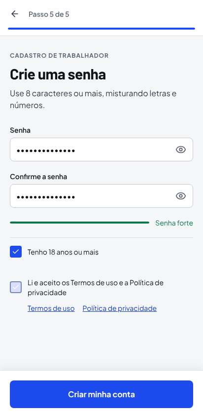

- confirme seu e-mail

  

- completar perfil oficio

  

- completar perfil especialidade

  

- mural do trabalhador

  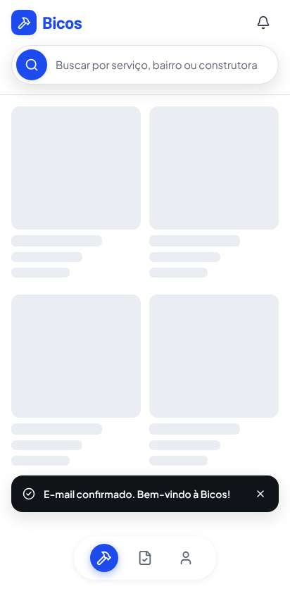

## 2. Cadastro da construtora → vaga com foto → mural (cidade e raio)

- construtora completa o perfil

  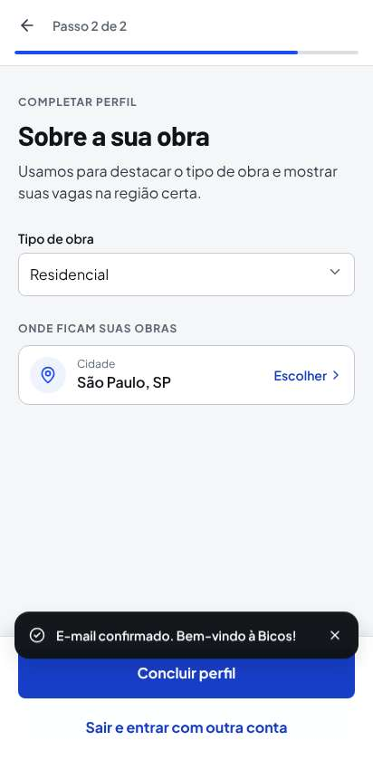

- publicar vaga passo 1

  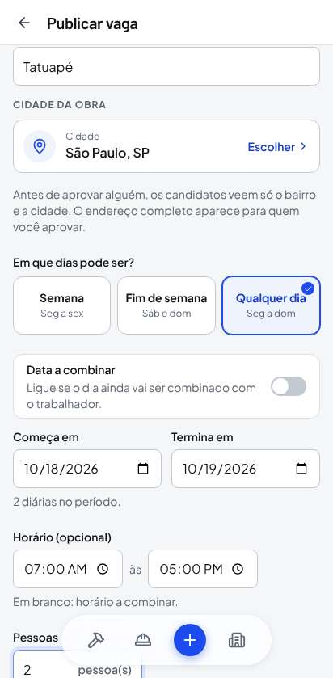

- publicar vaga passo 2

  

- vaga publicada

  

- mural por cidade mostra a vaga

  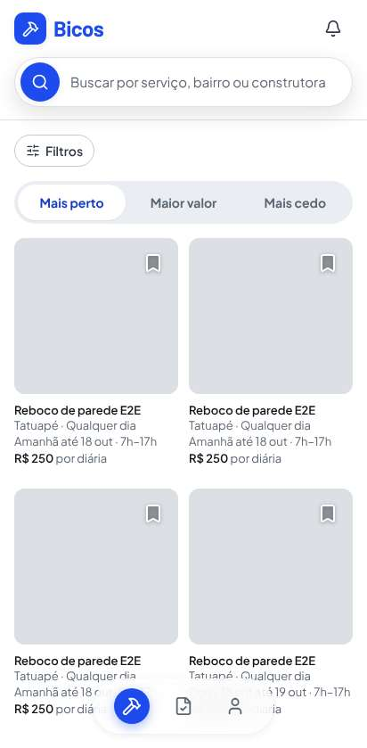

## 3. Candidatura → aprovação → WhatsApp liberado para os dois → recusa e desfazer

- detalhe da vaga

  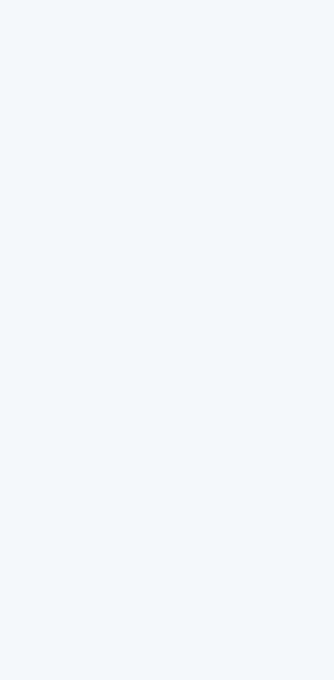

- candidatura enviada

  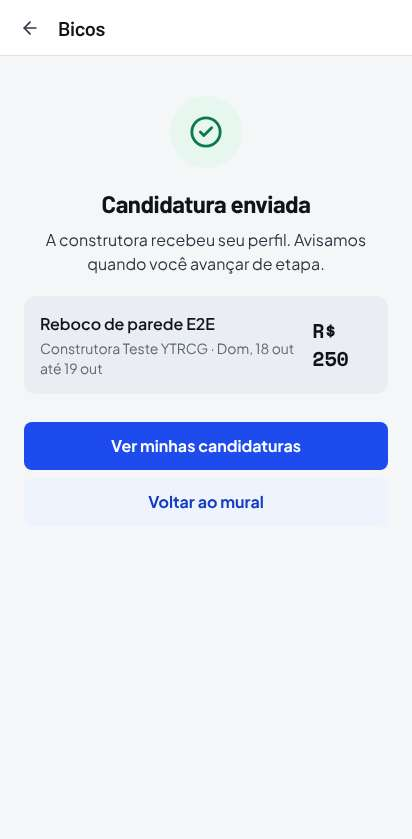

- construtora ve os candidatos

  

- aprovado whatsapp liberado para a construtora

  

- recusa desfeita

  

- whatsapp liberado para o trabalhador

  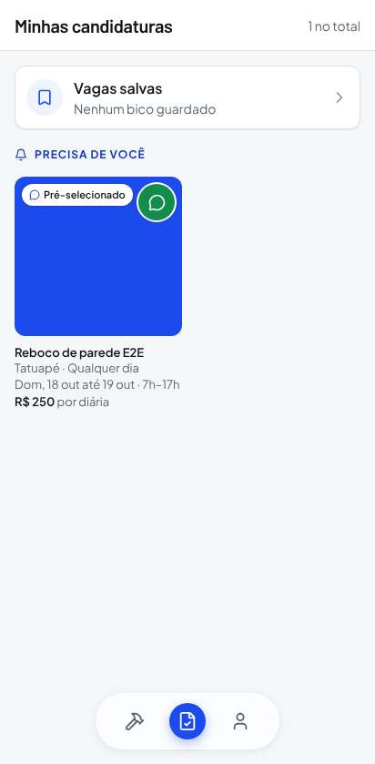

## 4. Presença → diária concluída → avaliação dos dois lados → notas nos perfis

- construtora confirma a contratacao

  

- trabalhador confirma presenca

  

- trabalhador avaliou a construtora

  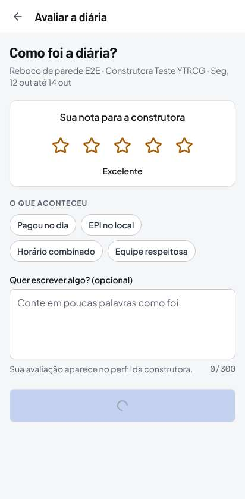

- construtora avaliou o trabalhador

  

- nota no perfil do trabalhador

  

- nota no perfil da construtora

  

## 5. Denúncia e bloqueio → exportar dados → excluir conta (Auth e Storage)

- denuncia

  

- bloqueio

  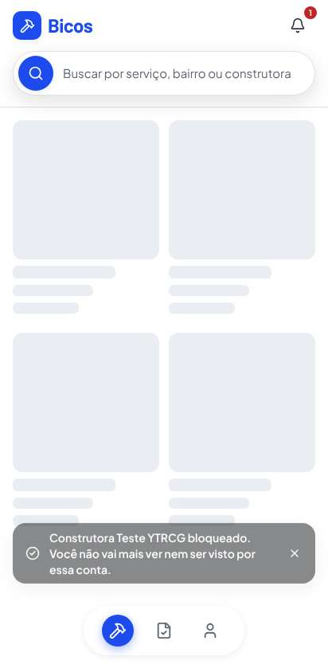

- exportar dados

  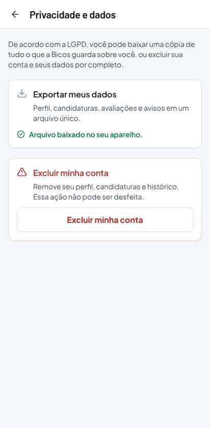

- confirmar exclusao

  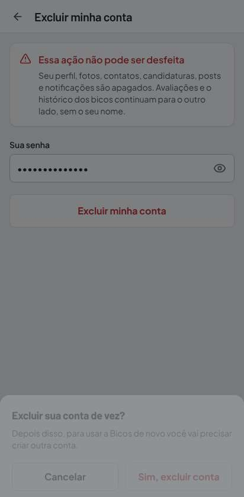

- conta excluida

  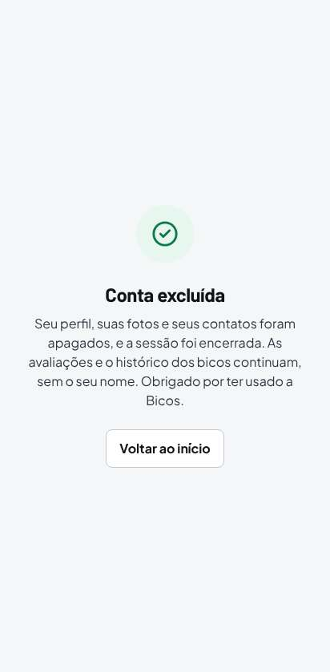

## 6. Login por CPF/CNPJ → limite de tentativas (429) → recuperação de senha

- entrou com cpf

  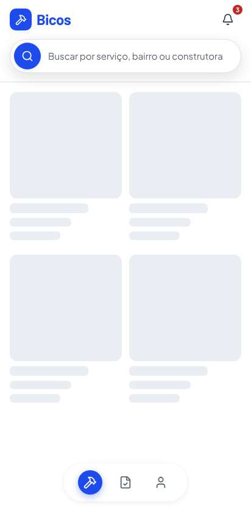

- entrou com cnpj

  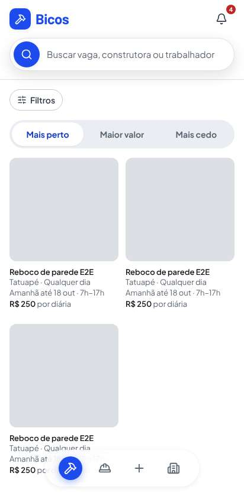

- link de recuperacao enviado

  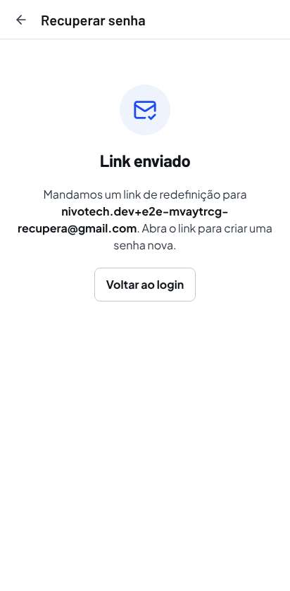

- senha nova salva

  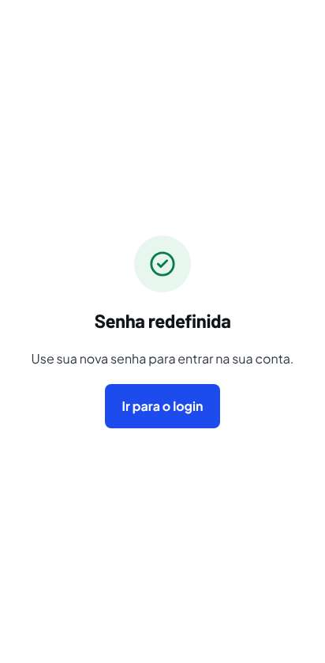

## 7. Área da equipe (L06): identidade, construtora, denúncia, suspensão e registro

- admin recusado para conta comum

  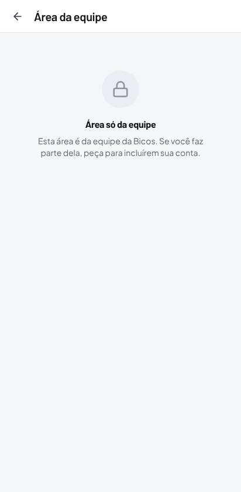

- consentimento da selfie

  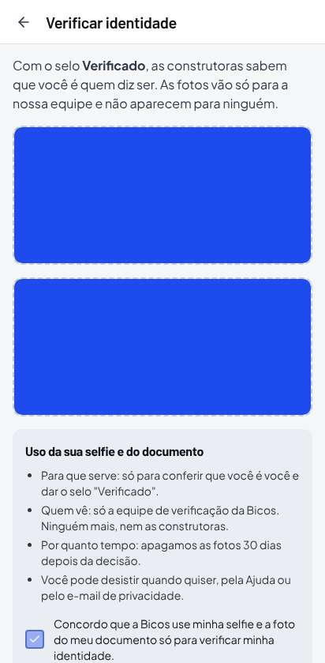

- fila de identidades

  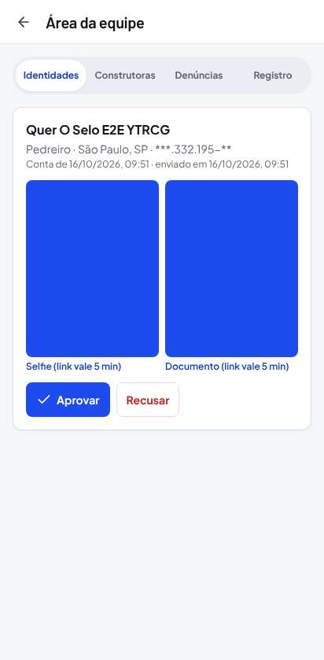

- fila de construtoras

  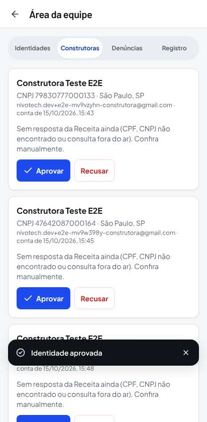

- fila de denuncias

  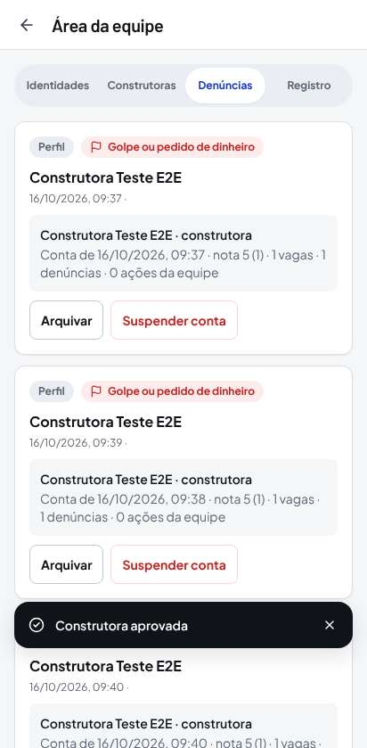

- conta suspensa nao entra

  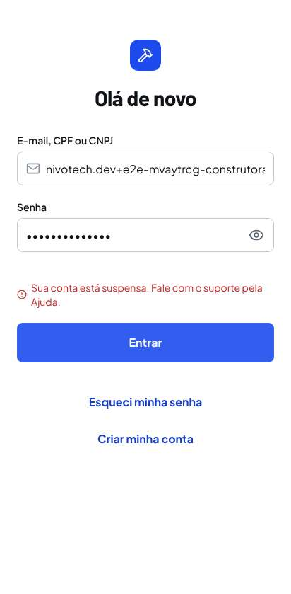

- registro de auditoria

  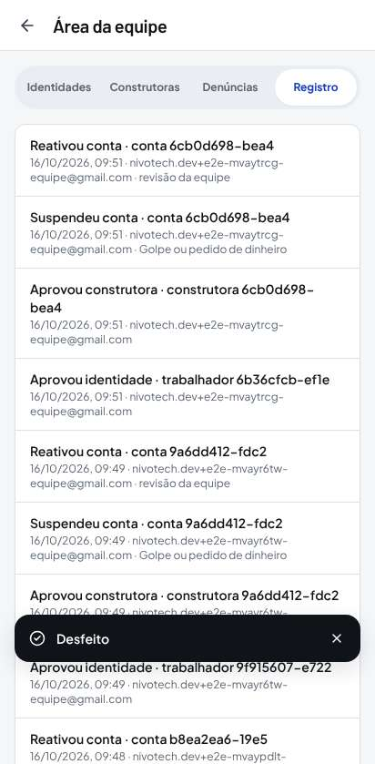
